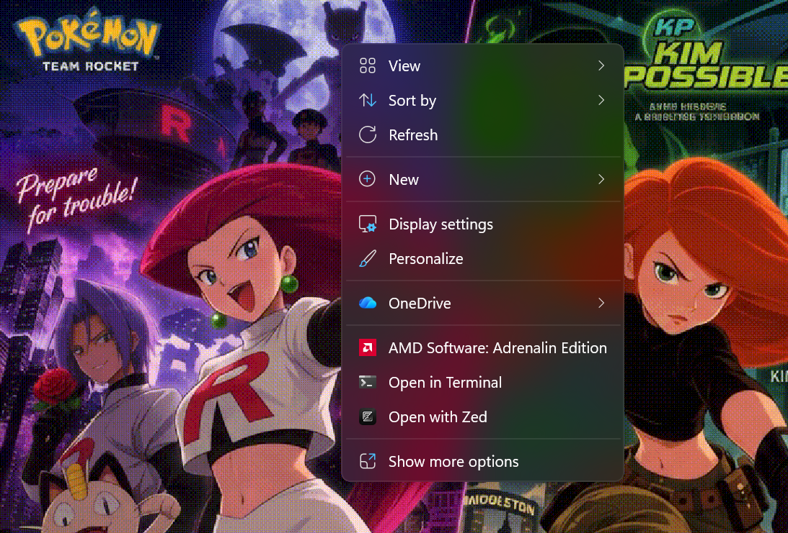
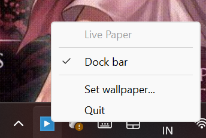
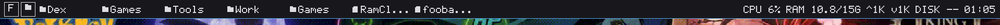
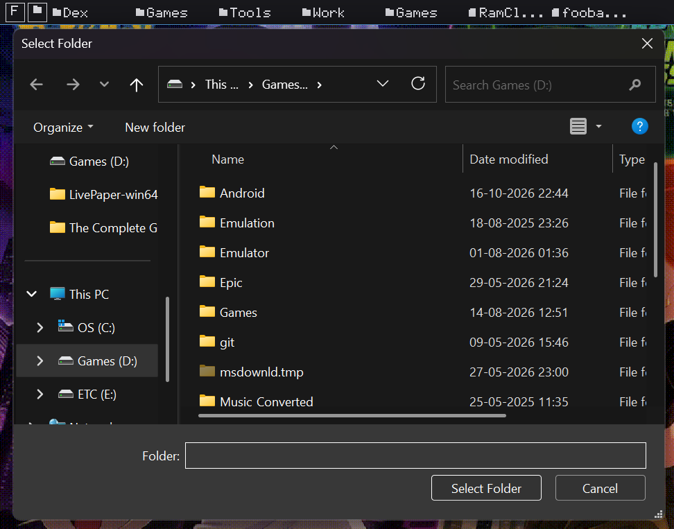
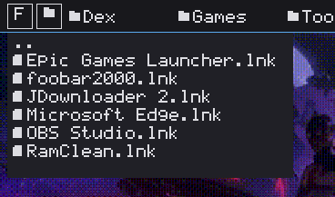
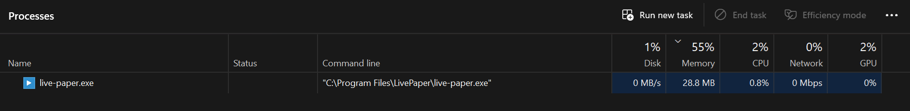

# LivePaper
 

LivePaper is a lightweight application that displays live wallpapers on Windows and Linux.
<br>Both gif and video files are supported. If FFmpeg can play the file, LivePaper can show it as your desktop background.


_Wallpaper art by [Toyoi Yuuta](https://twitter.com/1041uuu)_

## Installation
### Windows
Use the latest prebuilt binaries: [MSI installer](https://github.com/ZMajeh/LivePaper-Win11-Support/releases/download/latest/LivePaper-0.0.0-win64.msi) or [portable zip](https://github.com/ZMajeh/LivePaper-Win11-Support/releases/download/latest/LivePaper-0.0.0-win64.zip).

### Linux
Use the prebuilt package: [tarball](https://github.com/ZMajeh/LivePaper-Win11-Support/releases/download/latest/LivePaper-0.0.0-linux-x86_64.tar.gz). It contains the program in `bin/`; the libraries of SDL and of FFmpeg are the ones of your system.

You can also build it locally from source. Instructions are [here](#build).

## Usage
### Windows
Simply run live-paper.exe. On its first run, LivePaper will open a window to choose the wallpaper file. The app will remember this file and play it the next time you run LivePaper. You can also change the wallpaper file or quit the app via the tray icon.  


Note that if LivePaper quits due to an error, the remembered wallpaper file will be cleared. The next time the app is started, you will need to choose the wallpaper file again.



**Desktop mouse interaction:** Right-click (RMB) and left-click (LMB) on the desktop work normally. The wallpaper window is placed behind the desktop icons, so clicking on the desktop background or icons passes through to the Windows shell. You can still select, drag, and open desktop icons as usual. The dock bar at the top of the screen only receives mouse events when you hover over it.

### Tray icon menu

The tray icon in the notification area provides quick access to LivePaper's controls:



* **Dock bar** — A checkable item that toggles the dock bar on/off. When checked (default), the bar is visible and slides down on mouse hover. Uncheck it to hide the bar completely; check it again to restore it. This is equivalent to the `--no-dock` command-line option.
* **Set wallpaper...** — Opens a file dialog to choose a new video/GIF wallpaper.
* **Quit** — Exits LivePaper and restores the default Windows wallpaper.

### The bar of the dock

LivePaper shows a small bar at the top of the screen. It slides down when the mouse
reaches the top of the screen and it goes away again when the mouse leaves it.



The bar has two **add buttons** on the left (labeled "F" for *Add file* and a folder icon for *Add folder*), the files and the folders that were added to it in the middle, and the state of the system on the right: the load of the processor, the used memory, the speed of the network, the load of the disks and the time.

* The **Add file** button (labeled "F") opens a native Windows file dialog to pick a file. The chosen file is added to the bar: clicking it opens it with the program that belongs to it.
* The **Add folder** button (with a folder icon) opens a native Windows folder dialog to pick a folder. The chosen folder is added to the bar: clicking it shows a popup window with all files in that folder.



* Clicking a **folder item** on the bar opens a multi-column popup window below the bar showing all files and subfolders. The popup has a **search field** at the top for case-insensitive filtering. Clicking a subfolder in the popup navigates into that folder (opens another popup).



* The **items** of the bar are remembered between runs, in the file `dock.txt` next to the other settings of the program.
* The **details** on the right are sampled once per second, so that the program stays quiet. This includes CPU load, **RAM usage**, network speed, disk activity, and the current time.



The bar can be switched off and on again with the item *Dock bar* of the tray
menu, or with the option `--no-dock` when the program is started.

> **Note:** On Linux the add buttons currently open a menu with two options (*File browser* and *Add file or folder*) instead of native dialogs. Native file dialogs are planned for Linux as well.

#### Start LivePaper automatically on Windows 11

There are three ways to do it. The scheduled task is the most controllable one, because it lets you
start the app with a delay and with the wallpaper file as an argument.

**1. The scheduled task (recommended)**

LivePaper is a GUI program that attaches its window to the desktop of the *interactive* user
session, so the task has to run **"only when the user is logged on"**. A task that runs "whether the
user is logged on or not" (or at boot, before the logon) runs in a non-interactive session, where
there is no desktop to attach the wallpaper to.

Open the Task Scheduler (`Win` + `R`, then `taskschd.msc`), right-click **Task Scheduler Library** and
choose **Create Task...** (not "Create Basic Task"). Then:

| Tab | Setting | Value |
| --- | --- | --- |
| General | Name | `LivePaper` |
| General | Run only when user is logged on | selected (do *not* pick "Run whether the user is logged on or not") |
| General | Run with highest privileges | not needed |
| Triggers | New... → At log on | Specific user: your account |
| Triggers | Advanced... → Delay task for | `30 seconds` |
| Actions | New... → Action | `Start a program` |
| Actions | Program/script | `C:\Program Files\LivePaper\live-paper.exe` |
| Actions | Add arguments | `"C:\Users\mundh\OneDrive\Documents\Video wallpaper final(1).gif"` |
| Actions | Start in | `C:\Program Files\LivePaper` |
| Conditions | Start the task only if the computer is on AC power | unchecked (on a laptop) |
| Settings | Stop the task if it runs longer than | `PT0S` (unlimited) |
| Settings | If the task fails, restart every | `1 minute`, up to `3` times |

The four settings that are easy to get wrong:

* **"Start in"** must be the installation folder. LivePaper loads its tray icon from the relative
  path `icon.ico`, which is resolved against the working directory of the process; without this the
  program starts, but the tray icon is missing and the app can only be closed with the task manager.
* The **arguments** have to be quoted, because the path contains spaces and parentheses.
* The **delay** is needed because LivePaper needs the desktop of Explorer to exist before it can
  attach the wallpaper to it. Without the delay the program can start too early, fail with
  "can't find the Progman window of the desktop" and show an error box at logon.
* The **execution time limit** of a task is 3 days by default. A live wallpaper runs until the user
  logs off, so the limit has to be removed.

The same task from the command line (PowerShell, run it as administrator):

```powershell
$action = New-ScheduledTaskAction -Execute 'C:\Program Files\LivePaper\live-paper.exe' `
    -Argument '"C:\Users\mundh\OneDrive\Documents\Video wallpaper final(1).gif"' `
    -WorkingDirectory 'C:\Program Files\LivePaper'
$trigger = New-ScheduledTaskTrigger -AtLogOn -User 'mundh'
$trigger.Delay = 'PT30S'
$settings = New-ScheduledTaskSettingsSet -AllowStartIfOnBatteries -DontStopIfGoingOnBatteries `
    -StartWhenAvailable -ExecutionTimeLimit ([TimeSpan]::Zero)
$principal = New-ScheduledTaskPrincipal -UserId 'mundh' -LogonType Interactive -RunLevel Limited
Register-ScheduledTask -TaskName 'LivePaper' -Action $action -Trigger $trigger `
    -Settings $settings -Principal $principal `
    -Description 'Starts the LivePaper live wallpaper at logon'
```

(`LogonType Interactive` is the equivalent of "run only when the user is logged on".)

`schtasks` can create the task as well, but it has no option for the working directory, so the tray
icon would be missing:

```bash
schtasks /Create /TN "LivePaper" /SC ONLOGON /DELAY 0000:30 /IT /F \
  /TR "\"C:\Program Files\LivePaper\live-paper.exe\" \"C:\Users\mundh\OneDrive\Documents\Video wallpaper final(1).gif\""
```

Test the task without rebooting:

```bash
schtasks /Run /TN "LivePaper"
schtasks /Query /TN "LivePaper" /V /FO LIST
```

If the program does not start, the log of the task scheduler is in the Event Viewer under
*Applications and Services Logs → Microsoft → Windows → TaskScheduler → Operational*, and the
diagnostics of the program itself can be written to a file with the console variant:
`live-paper-console.exe --verbose --log-file=live-paper.log`.

**2. The startup folder**

`Win` + `R`, then `shell:startup`, and put a shortcut to `live-paper.exe` there. Right-click the
shortcut → *Properties* → *Shortcut* tab → set *Start in* to `C:\Program Files\LivePaper` and put the
path of the wallpaper into *Target*, after the program:

```
"C:\Program Files\LivePaper\live-paper.exe" "C:\Users\mundh\OneDrive\Documents\Video wallpaper final(1).gif"
```

**3. The registry (the "Startup apps" list of Windows 11)**

`Win` + `R`, then `regedit`, and create this value:

```
HKEY_CURRENT_USER\Software\Microsoft\Windows\CurrentVersion\Run
    LivePaper (REG_SZ) = "C:\Program Files\LivePaper\live-paper.exe" "C:\Users\mundh\OneDrive\Documents\Video wallpaper final(1).gif"
```

The entries of this key are the ones that are listed in *Task Manager → Startup apps* and in
*Settings → Apps → Startup*, where they can be enabled and disabled by the user.

**A note about OneDrive**

If the wallpaper file is stored in OneDrive, make sure that it is available locally at the logon:
right-click the file → *Always keep on this device*. Otherwise the file can still be a cloud
placeholder when the task starts, the program cannot read it and it quits with an error.

### Linux
LivePaper is a console application on Linux.
```
Usage: live-paper [-hv] [--stats] [--log-file=<path>] [--fit-mode=<mode>] [<file>]
Display a video or an animated file as desktop background.

  -h, --help   = display this help and exit
  -v, --verbose = print detailed diagnostics
  --stats      = print runtime statistics every few seconds
  --log-file=<path> = write diagnostics to the given file
  --fit-mode=<mode>
               = controls the way the wallpaper is fit on screen
                 possible values: fit, fill, center
  <file>       = video or animation file to display

Examples: live-paper loop.mp4
          live-paper --fit-mode=fill wallpaper.gif
          live-paper --verbose --stats --log-file=live-paper.log loop.mp4
```

Append `&` to run LivePaper in background. Run `killall live-paper` to stop it.

## Diagnostics
LivePaper can report what it is doing, which is useful when a wallpaper doesn't
show up or a file doesn't play. Diagnostics are written to stderr and can also
be saved to a log file with `--log-file`.

```
live-paper --verbose --stats --log-file=live-paper.log loop.mp4
```

The startup report shows whether the file is readable and what it contains,
whether the wallpaper was actually attached to the desktop, and the memory
usage of the process:

```
[2026-10-20 16:37:54] INFO : live-paper starting, file='assets/test.gif'
[2026-10-20 16:37:54] INFO : SDL 2.32.4 initialized
[2026-10-20 16:37:54] INFO : X11 display ':0' opened, screen 0 is 1920x1080
[2026-10-20 16:37:54] INFO : drawing onto the root window of ':0' (1920x1080)
[2026-10-20 16:37:54] INFO : renderer: opengl (video driver: x11)
[2026-10-20 16:37:54] INFO : loaded 'assets/test.gif': format=gif codec=gif size=1000x562 duration=3.84s fps=8.33 file_size=372242
[2026-10-20 16:37:54] INFO : wallpaper: set (X11 root window)
[2026-10-20 16:37:54] INFO : media: format=gif codec=gif resolution=1000x562 duration=3.84s fps=8.33 file_size=363.5 KiB
[2026-10-20 16:37:54] INFO : memory: rss=137.5 MiB peak_rss=142.2 MiB system_total=7.4 GiB
```

With `--stats` the frame rate, frame counters and memory usage are printed
every five seconds:

```
[2026-10-20 16:37:59] INFO : stats: fps=8.3 frames_decoded=42 frames_rendered=42 loops=1 last_decode=2.0ms rss=165.5 MiB
```

| Option | Description |
| --- | --- |
| `-v`, `--verbose` | Enable debug level messages |
| `--stats` | Print runtime statistics every few seconds |
| `--log-file=<path>` | Also write the diagnostics to the given file |

On Windows the application has no console window, so use `--log-file` to
capture the diagnostics, or attach a debugger to see them in the output window.

## Build
### Windows
Visual Studio 2019 or later is recommended. CMake will download all dependencies during configuration when building with VS.

You can do everything from Visual Studio, if desired. Choose "Clone a repostiory..." from the startup menu to clone this repository. VS will configure the project using CMake. Then build as usual.

You can also build in terminal, similarly to the Linux instructions below. You need to install the requirements manually if using e.g. MinGW.

### Linux
Install the requirements
- cmake 3.14
- ffmpeg OR libavcodec-dev libavformat-dev libavutil-dev libswscale-dev libavdevice-dev for Ubuntu and the like
- sdl2

Example for Ubuntu 

```bash
$ sudo apt-get -yq install cmake libsdl2-dev libavcodec-dev libavformat-dev libavutil-dev libswscale-dev libavdevice-dev
```

For Arch
```bash
$ sudo pacman -S cmake sdl2 ffmpeg
```

Then clone the repository, configure and build with CMake.
```bash
$ git clone https://github.com/ZMajeh/LivePaper-Win11-Support.git && cd LivePaper-Win11-Support
$ cmake -B build
$ cmake --build build
```
To test, run
```
$ ./build/live-paper assets/test.gif &
```

To build the package that is published in the release, run
```bash
$ cd build && cpack -C Release
```
The result is in `build/dist/`.

### Cross-compiling for Windows from Linux
The Windows executable can also be built on Linux with the MinGW-w64 toolchain.
The required dependencies (SDL2 and FFmpeg) are downloaded automatically.

```bash
$ sudo apt-get -yq install mingw-w64 cmake curl unzip tar zip
$ ./makeLinuxToWindow.sh
```

The result is placed in `dist-windows/`, together with a `LivePaper-win64.zip`
archive that contains the executable and the DLLs it needs. Copy the whole
folder to a Windows machine and run `live-paper.exe`.

The script accepts a few options; run `./makeLinuxToWindow.sh --help` for the
full list.

```bash
$ ./makeLinuxToWindow.sh --output /tmp/win --build-type Debug
```

## Known Issues
* Probably not all video file types are supported at the moment; let me know if your file doesn't work
* Unicode is not fully supported on Windows yet
* Doesn't work with compositors on Linux (yet?)
* App quits with an error if it finds any issue with the input file
* Only one display is supported

## Notice

Art by [Toyoi Yuuta](https://twitter.com/1041uuu) is used for test wallpapers.
